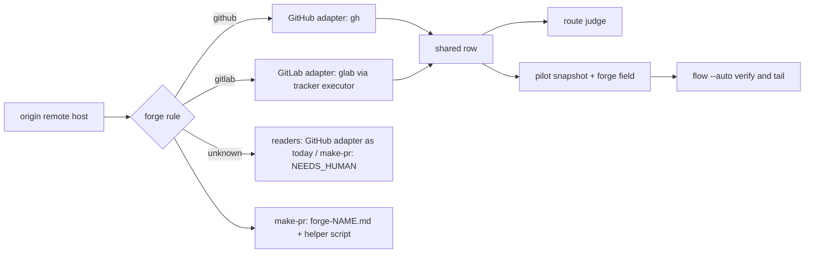

# Forge adapters and make-pr over GitLab merge requests

> **Refined 2026-11-02** for GitHub issue #462 (reporter @TechupBusiness, who offered to test a branch on a GitLab repo). fn-69 and fn-139 have landed, so the GitLab transport groundwork exists. The merge-request `glab` commands are unverified until the first task records them.
>
> **Split 2026-11-04** into three specs, shipped in order: this one (forge adapters, make-pr, and `flow --auto` up to an open MR), then resolve-pr over MR discussions, then land and merge evidence. Customers are blocked on make-pr first.
>
> **Planned 2026-11-04.** Planning settled the row shape, where the forge rule lives, the GitLab transport and the make-pr reads (Decision Context, "Planning decisions").

## Goal & Context
<!-- scope: business -->

flow-next's **code-review / ship pipeline** — `/flow-next:make-pr`, `/flow-next:resolve-pr`, `/flow-next:land` — assumes **GitHub**: it shells out to `gh` and operates on **Pull Requests** + PR review threads (GraphQL). Companies that host their **code** on **GitLab** (not just their tracker) are locked out of the pipeline even though their issues could sync via fn-69.

This is the **code-hosting** counterpart to fn-69 (which is the *tracker/issue* side). This spec lays the forge seam every later forge uses and makes make-pr open and update **GitLab Merge Requests** via **`glab`**, so `flow --auto` on a GitLab origin ends at an open MR. resolve-pr and land over MRs follow in their own specs. **Distinct from fn-69**: fn-69 mirrors specs to GitLab *issues*; this drives GitLab *merge requests*.

As of 9.5.1, a GitLab-hosted run gets past `flow --auto`'s PR probe (#583, fn-310) and make-pr stops cleanly with `NEEDS_HUMAN` before any close or push. This spec replaces that stop with a working merge-request path.

## Architecture & Data Models
<!-- scope: technical -->

- **Reuse fn-69's groundwork:** same `glab` auth and self-managed host handling, same token-scope findings (`api`).
- **Self-managed first-class** — same as fn-69; never assume gitlab.com.
- **Shape decided 2026-11-02, amended 2026-11-04.**
  - **The forge is derived from the origin remote.** github.com, or a host `gh` is logged in to, means GitHub. A GitLab host (gitlab.com, `CI_SERVER_HOST`, or a host `glab` is logged in to) means GitLab. There is no config key and nothing is persisted, so the tracker axis and the forge axis stay independent: GitLab issues with GitHub code still works, and so does the reverse.
  - **flowctl answers questions; skills act.** flowctl owns deterministic reads only. Every action (create or update the MR, and later reply, resolve and merge) stays with the agent, using the forge's own CLI as that forge's skill reference describes.
  - **Each forge is an internal adapter behind one interface.** In this spec an adapter answers: does this origin host belong to me, and which PRs or MRs exist for a branch (or are open), as the shared row. Later specs add reads to the same interface (merge evidence, merge readiness). An adapter may lack a read; callers then report that read as unsupported on that forge in one generic message. A registry keyed by forge name holds the adapters; the flowctl callers dispatch through it and never name a forge. Internal function names are forge-neutral. A later forge (Bitbucket Cloud, Bitbucket Data Center) adds one adapter and one reference per skill and changes no flowctl caller. The interface is internal: no public flowctl verb.
  - **The shared row keeps the shape callers already read:** `number`, `url`, `state` (`OPEN` / `CLOSED` / `MERGED`), `headRefName`, `headRefOid`, `mergedAt`, plus `baseRefName` where make-pr needs it. The GitHub adapter returns today's `gh` rows unchanged; other adapters map into them (GitLab: `iid`, `web_url`, `opened` and `locked` to `OPEN`, `source_branch`, `sha`, `merged_at`, `target_branch`).
  - **Each skill dispatches on the forge by name.** make-pr resolves the forge once; for any forge other than GitHub it reads that forge's reference (`forge-gitlab.md` beside make-pr). A new forge is a new reference file, not a new conditional. GitHub skill paths keep their behaviour; the one shared make-pr script selects the forge's read helper in a single guard (Decision Context).



## API Contracts
<!-- scope: technical -->

- Internal only. The adapter registry maps a forge name to its reads; the shared lookup takes a repo and a branch (or "open"), returns rows in the shape above or a probe failure. A failed or truncated read is a probe failure, never an empty list.
- `flowctl pilot snapshot` gains a top-level `forge` field (`github`, `gitlab`, or `null` for an unknown host). It is the only output shape this spec adds.
- Commands recorded live before relying (R11): MR list by `source_branch` (all states and open), single MR view, MR create, MR update (description, title for draft or ready), the `source_branch` "does not exist" answer, token self-read for scope, and `glab auth status --hostname` for a logged-in and a logged-out host.

## Edge Cases & Constraints
<!-- scope: technical -->

- Token scope: writing MRs needs `api` scope. make-pr checks it before the spec is closed or anything is pushed.
- A missing or unauthenticated `glab` on a recognisable GitLab origin stops make-pr before any close or push, naming `glab auth login --hostname <host>`. An origin neither CLI claims stops with one message naming both `gh auth login` and `glab auth login`.
- `glab api --hostname` rejects `host:port`; the GitLab adapter passes the host through `GITLAB_HOST` instead. The origin's port matters (`localhost:8929`).
- `glab` stores tokens in the OS keyring by default, so the tracker credential ladder (which reads glab's config file) cannot see them. The GitLab adapter uses the `glab` CLI route, which can.
- GitLab caps a page at 100; open listings paginate, and a listing that cannot prove it is complete is a probe failure.
- MRs from forks share branch names; only MRs whose source project is the origin project count.
- Drafts are the `Draft: ` title prefix. `--ready` on a draft removes the prefix (also `[Draft]` and `(Draft)`); `--update` keeps the current draft state.
- Until land's GitLab path ships, `flow --auto --until=merge` on a non-GitHub forge stops after make-pr with the MR URL and `NEEDS_HUMAN`; it never dispatches land on an MR. Goal mode's integration-branch PR stops `NEEDS_HUMAN` on a non-GitHub forge.

## Acceptance Criteria
<!-- scope: both -->

- *(R1–R3 were stubs, superseded by R4–R12; R7–R9 moved to the resolve-pr and land specs in the 2026-11-04 split.)*
- **R4:** The forge comes from the origin remote's host, with no config key. On an origin neither CLI claims, make-pr stops with `NEEDS_HUMAN` naming both CLIs' login commands; flowctl's readers keep today's behaviour there (the GitHub adapter, with fn-310's "no PR on a non-GitHub forge" answer). [paraphrase] Errors: no origin remote, an SSH host alias, a host with a port, an offline or slow `glab auth status` (reads as unknown, never as GitHub), an enterprise `gh` token that claims every host (glab is asked first, in make-pr and flowctl alike).
- **R5:** The route judge and the pilot snapshot (open listing and per-branch history) read PRs and MRs through one internal lookup dispatched through the adapter registry, `flow --auto`'s make-pr verify reads the same answer on a non-GitHub forge, and no public flowctl verb is added. Spec-approval rows stay a GitHub read and report "unsupported on this forge" elsewhere; tracker merge evidence moves in fn-317. [paraphrase] Errors: `glab` missing or failing, malformed rows, a listing that may be truncated: each is a probe failure, never "no MR".
- **R6:** On a GitLab origin, make-pr opens or updates a merge request with the same rendered body and close behaviour it uses on GitHub, replacing today's `NEEDS_HUMAN` stop. [inferred] Errors: `glab` absent or logged out, a token without `api` scope (stops before close), an existing open or locked MR without `--update`, an existing-MR or parent read that fails or is malformed (stops before close, never read as "no MR"), a just-pushed branch GitLab cannot see yet (retried on GitLab's exact answer), `--draft` / `--ready` / `--update` on a draft MR.
- **R10:** Behaviour on a GitHub origin is unchanged: the existing make-pr, land, resolve-pr, route, pilot, merge-evidence and flow-auto tests whose subject is unchanged pass unmodified, including fn-310's tests for origins neither CLI claims. [inferred] Errors: no new subprocess before `gh` on the GitHub path that breaks tests stubbing on the command name.
- **R11:** Each `glab` command this spec relies on is first run against a live GitLab project and its real output saved as a test fixture. Tests with a stubbed `glab` built from those fixtures cover R4–R6, R12 and R13 in CI. [inferred] Errors: none beyond the fixtures being real output (recorded, not hand-written).
- **R12:** Forge-specific reads sit behind one internal adapter interface with a registry keyed by forge name, and skills load a forge's reference by name. No flowctl caller branches on a forge, and a test adapter registered in the tests is detected and answers the shared lookup without any caller changing. [paraphrase] Errors: an adapter lacking a read answers "unsupported on this forge", never a crash.
- **R13:** On a GitLab origin, a spec that depends on another spec's branch gets the same base selection make-pr applies on GitHub: it targets the parent branch while the parent's MR is open, the default branch once the parent's MR is merged, and reads merged parent history through the MR's ref. [inferred] Errors: the parent MR state unreadable (stops `NEEDS_HUMAN` as on GitHub).

## Early proof point

Task fn-73-glab-git-ops-make-prresolve-prland-over.1 validates the core approach (the forge rule and the adapter registry answer the route judge and pilot snapshot for GitHub unchanged and for the live GitLab project, with a test-registered fake forge needing no caller change). If it fails, re-evaluate the registry shape before continuing with .2+.

## Quick commands

```bash
python3 -m unittest plugins/flow-next/tests/test_forge.py plugins/flow-next/tests/test_judge_route.py plugins/flow-next/tests/test_pilot_snapshot.py
python3 -m unittest plugins/flow-next/tests/test_make_pr_preflight_auth.py plugins/flow-next/tests/test_make_pr_close.py plugins/flow-next/tests/test_flow_auto.py
GITLAB_HOST=localhost:8929 glab api projects/flownext%2Fflownext   # live test project, maintainer-local
```

## Boundaries
<!-- scope: business -->

- **Not fn-69** — fn-69 is tracker/issue projection; this is code hosting.
- **GitHub/Linear/Jira unaffected** — additive forge.
- **fn-69 and fn-139 have landed.** Reuse their `glab` transport and recorded `glab` defects; don't build a second transport.
- No `forge.type` config key and no public forge verbs; the adapter interface stays internal to flowctl (see Architecture).
- No resolve-pr or land over MRs here; they are the next two specs. Tracker merge evidence over MRs is fn-317's.
- Spec approval through PR reviews stays GitHub-only.
- Goal mode's integration-branch PR stays GitHub-only.
- No Bitbucket, Gitea or other forges.
- The full live GitLab end-to-end run (idea → merged MR) happens after the land spec. The reporter of #462 offered to test a branch.

## Strategy Alignment

Active tracks served by this plan:
- **Cross-platform parity** — extends parity from *trackers* (fn-69/70) to *code hosting*, starting with the step GitLab teams are blocked on.

## Decision Context
<!-- scope: both -->

### Motivation
Companies hosting code on GitLab want flow-next's full pipeline, not just issue sync. make-pr is the first blocker customers hit, so it ships first, on the seam the later specs reuse. A disposable self-managed GitLab EE instance (Free tier, later an Ultimate trial for fn-317) is the live test project.

### Implementation Tradeoffs
- **Forge from origin, not a config key.** make-pr's preflight already reads the origin host, and a key could disagree with the remote. The cost is that a repo can't route to GitLab while origin points elsewhere.
- **Seams plus one shared lookup, not a forge layer (#462's proposal).** GitHub paths in the skills stay exactly as they are and are already proven, so the risk sits only in the new GitLab arms. The forge layer would mean about eight new flowctl verbs and rewriting land and resolve-pr's working GitHub paths, against "flowctl grows only under burden of proof" and "Agent first". A third forge later adds one branch to the shared lookup and one reference per skill. That is also the point to extract a layer, designed from three real implementations.
- **Amended 2026-11-04: internal adapters now, not branches.** The maintainer wants a forge added later without touching callers, not an if/else that is refactored at forge three. The adapter interface and registry stay internal (no public verbs, no config key), so the cost is moving the existing `gh` lookups behind the GitHub adapter, guarded by R10's unchanged tests. The interface is designed from two forges, so a third may still widen it; that is accepted.
- **Amended 2026-11-04: reads in flowctl, actions in skills.** Decisions that would otherwise be copied into every forge's prose (which forge, which PR, and later green, approved, merged) live once in tested Python. Actions stay agent-driven through each forge's reference. This keeps machinery minimal and the agent in charge.
- **Split 2026-11-04.** One spec covering make-pr, resolve-pr, land and merge evidence was one very large PR, and customers would wait for all of it. Three specs ship the make-pr unblock first; each is planned, reviewed and landed on its own.
- **Record before relying.** fn-69 verified `glab` for issues only. No merge-request command has been run, so fixtures come from a live project first.

### Planning decisions (2026-11-04)
- **Row shape: today's `gh` keys.** The pilot snapshot, route judge and their tests read `OPEN`/`MERGED`/`CLOSED`, `headRefName`, `headRefOid` and `mergedAt`. Keeping those keys as the shared row leaves every GitHub consumer untouched; other adapters map into it.
- **R5 narrowed to the readers this spec needs.** The route judge and pilot snapshot drive `flow --auto`. Spec-approval rows need PR review data no shared row carries, so they stay a GitHub read with a clear "unsupported on this forge" elsewhere. Tracker merge evidence reads drafts and changed files and belongs with merged-MR evidence in fn-317.
- **Forge rule in Python and in make-pr's shell, pinned equal.** flowctl's readers need it in Python. make-pr's preflight keeps its GitHub fast path in shell exactly as today (its tests run that block without flowctl), so the GitLab arm sits beside it in shell. A parity test feeds the same origin cases to both, the repository's existing pattern for duplicated constants. This avoids a new flowctl verb, and `flowctl preflight` is a planning bundle too heavy for make-pr's first step.
- **GitLab transport: the `glab` CLI through the tracker executor**, with the request carrying `GITLAB_HOST` (host and port) in its environment. The CLI route sees keyring-stored tokens and gets the executor's stdout-noise strip, retries and error classes. Without the optional tracker package, GitLab reads are probe failures.
- **make-pr's three `gh` reads go through one forge guard.** The parent-PR lookup, the existing-PR check and the prior-PR count in the shared preflight script run the forge's read helper, which answers in `gh`'s JSON keys, so the logic after each read is shared. Creation and update keep `make-pr-create.sh`'s existing create-command seam. This guard is the one place make-pr's shared script names the forge.
- **Unknown hosts.** Only gitlab.com and `CI_SERVER_HOST` are recognisable without credentials; a self-managed host with logged-out `glab` reads as unknown. make-pr's one stop message for that case names both login commands, and fn-310's text stays for its existing tests.
- **Measurement waiver.** The prose changes add a non-GitHub arm and leave GitHub agent behaviour unchanged, so no eval round; the live end-to-end make-pr run on the test project is the evidence.

Maintainability (plan review): duplication - the forge rule exists in Python and in make-pr's shell, accepted and pinned by a parity test; structure - none identified

## Memory findings

| Track | Category | Entry | Why relevant |
|---|---|---|---|
| bug | integration | bundled-snapshot-pr-listing-truncation-2026-09-26 | the pilot's PR listing truncation and partial-history rules the GitLab listing must keep |
| bug | runtime-errors | skill-fences-that-degrade-only-without-2026-09-13 | make-pr fences masked failing forge calls; the GitLab arm must fail loudly |
| bug | runtime-errors | structured-review-parsers-must-2026-07-30 | a failed read must never look like an empty answer ("no MR") |
| bug | integration | heredoc-built-json-breaks-on-free-form-2026-06-05 | MR bodies go as JSON on stdin, built by a tool, never by heredoc |
| knowledge | workflow | split-pr-at-second-adjacent-surface-finding-2026-08-21 | keep this PR to make-pr and the readers; adjacent surfaces go to follow-ups |

## Conversation Evidence
> user: "might be worth creating a stub spec for using this gitlab for testing glab for git ops too for our companies that use gitlab instead of github for code hosting" (2026-06-28)

## Cross-spec dependency (added 2026-07-26)

**Depends on [[fn-139-tracker-sync-determinism-flowctl-owns]].**

fn-139 moves GitLab issue transport out of skill prose and into deterministic flowctl Python, which means it builds the `glab` subprocess plumbing this spec also needs: token/host resolution for self-managed instances, the tier probe (`GET /namespaces/:id -> plan`), and the structured error shape.

It also captures two measured `glab` defects that this spec would otherwise rediscover:

- **`glab` prints its "Multiple config files found" warning to STDOUT**, corrupting JSON parsing.
- **`glab api -F file=@` produces invalid multipart** and **`-f "assignee_ids[]="` is not array-encoded** - both require raw curl.

This spec targets Merge Requests rather than issues, so it is not blocked on fn-139's semantics - only on reusing its transport layer instead of deriving a second, divergent one.

Overlaps to rebase on, no dependency: fn-315 edits the same route-judge and pilot-snapshot functions; fn-268 edits the same `flow --auto` tail prose.

## Resolved via Codebase
- **Where gh is wired in.** flowctl: `_gh_pr_rows` (`scripts/flowctl.py:23590`, used for spec-approval PRs at :23655, :23919 and :23932), `judge_route_state` (:24039), `pilot_snapshot` (:43689), and tracker `merge_evidence` (`scripts/flowctl_tracker/status/policy.py:123`, which also runs `gh pr view` for changed files at :186). Skills: `scripts/make-pr-create.sh`, `scripts/make-pr-preflight.sh` (the origin check at :7-17, and a stacked-PR fetch of `refs/pull/<n>/head` at :75), `skills/flow-next-land/workflow.md` (compare, rulesets, update-branch, run rerun, merge with `--match-head-commit`), `skills/flow-next-resolve-pr/workflow.md` and its four GraphQL scripts, plus the PR probes in `skills/flow-next-flow/auto.md:447` and `references/tail.md:22-49`.
- **The origin check already exists.** `make-pr-preflight.sh:7-17` reads the origin host and stops on a non-GitHub host. That makes it the natural place for the forge decision.
- **The GitLab credential ladder exists.** `scripts/flowctl_tracker/credentials.py:32-86` reads `GITLAB_TOKEN` or glab's per-host stored token.
- **No merge-request transport exists.** The only `glab mr` call in the repo is read-only `glab mr list` in `agents/why-scout.md:32`.
- **Row consumers (planning, 2026-11-04).** `_gh_pr_rows` needs `reviews` and `mergedBy`; the pilot joins on `headRefName` and reads `headRefOid`; `merge_evidence` reads `isDraft` and changed files through the tracker executor with `provider="github"`. The glab stdout strip in `flowctl_tracker/executor.py` applies only to `provider="gitlab"` requests.
- **Keyring tokens (live, 2026-11-04).** glab 1.124 stores a new login in the OS keyring (`use_keyring: "true"`, no token in `config.yml`), which the credential ladder above does not read.

## Resolved via Project Docs
- **fn-69 and fn-139 are done** (`.flow/specs/fn-69-*.json`, `.flow/specs/fn-139-*.json`, status `done`). Their verified `glab` set covers issues only (`.flow/specs/fn-69-tracker-sync-gitlab-adapter-glab-cli.md:16`).
- **Strategy rules.** "flowctl grows only under burden of proof" and "Agent first" (`STRATEGY.md:27-28`) argue against new public verbs and a config key.

## Resolved via Contributor Research
Jan Hommels (@janhommels) ran the merge-request side of `glab` against a live self-managed GitLab in janhommels/flow-next#1. That PR adds public `flowctl forge` verbs and branches inside make-pr's shell scripts, so its shape is not adopted; its measurements are. They are the starting point for R11's fixtures, which are still recorded against a live project.
- **JSON writes need an explicit Content-Type.** `glab api --input` sends none, and GitLab rejects a JSON body without it. Sending the body on stdin also keeps large MR descriptions clear of Windows argv limits.
- **A just-pushed branch can be briefly invisible.** MR create answers `{"message":{"source_branch":["does not exist"]}}`; retry on that exact answer.
- **Open means `opened` plus `locked`.** An open-MR lookup that reads only `opened` misses locked MRs.
- **Drafts are a title prefix.** A draft MR is created with `Draft: ` in front of the title.
- **SSH host aliases resolve through `ssh -G`**, the same way git and gh resolve them, before the origin host is classified.
- **`GH_ENTERPRISE_TOKEN` makes gh claim every host.** When it is set, ask `glab auth status --hostname <host>` before gh.
- **A missing or failing `glab` is a probe failure, never "no MR".**
- **Merged MRs behind a commit:** `projects/:id/repository/commits/<sha>/merge_requests`, keeping `state == merged` (why-scout and the defect route).

## Requirement coverage

| Req | Description | Task(s) | Gap justification |
| --- | --- | --- | --- |
| R4 | The forge comes from the origin remote's host, with no config key. On an origin neither CLI claims, make-pr stops with `NEEDS_HUMAN` naming both CLIs' login commands; flowctl's readers keep today's behaviour there (the GitHub adapter, with fn-310's "no PR on a non-GitHub forge" answer). [paraphrase] Errors: no origin remote, an SSH host alias, a host with a port, an offline or slow `glab auth status` (reads as unknown, never as GitHub), an enterprise `gh` token that claims every host (glab is asked first, in make-pr and flowctl alike). | fn-73-glab-git-ops-make-prresolve-prland-over.1, fn-73-glab-git-ops-make-prresolve-prland-over.2 | — |
| R5 | The route judge and the pilot snapshot (open listing and per-branch history) read PRs and MRs through one internal lookup dispatched through the adapter registry, `flow --auto`'s make-pr verify reads the same answer on a non-GitHub forge, and no public flowctl verb is added. Spec-approval rows stay a GitHub read and report "unsupported on this forge" elsewhere; tracker merge evidence moves in fn-317. [paraphrase] Errors: `glab` missing or failing, malformed rows, a listing that may be truncated: each is a probe failure, never "no MR". | fn-73-glab-git-ops-make-prresolve-prland-over.1, fn-73-glab-git-ops-make-prresolve-prland-over.4 | — |
| R6 | On a GitLab origin, make-pr opens or updates a merge request with the same rendered body and close behaviour it uses on GitHub, replacing today's `NEEDS_HUMAN` stop. [inferred] Errors: `glab` absent or logged out, a token without `api` scope (stops before close), an existing open or locked MR without `--update`, an existing-MR or parent read that fails or is malformed (stops before close, never read as "no MR"), a just-pushed branch GitLab cannot see yet (retried on GitLab's exact answer), `--draft` / `--ready` / `--update` on a draft MR. | fn-73-glab-git-ops-make-prresolve-prland-over.2, fn-73-glab-git-ops-make-prresolve-prland-over.3, fn-73-glab-git-ops-make-prresolve-prland-over.4 | — |
| R10 | Behaviour on a GitHub origin is unchanged: the existing make-pr, land, resolve-pr, route, pilot, merge-evidence and flow-auto tests whose subject is unchanged pass unmodified, including fn-310's tests for origins neither CLI claims. [inferred] Errors: no new subprocess before `gh` on the GitHub path that breaks tests stubbing on the command name. | fn-73-glab-git-ops-make-prresolve-prland-over.3, fn-73-glab-git-ops-make-prresolve-prland-over.4 | — |
| R11 | Each `glab` command this spec relies on is first run against a live GitLab project and its real output saved as a test fixture. Tests with a stubbed `glab` built from those fixtures cover R4–R6, R12 and R13 in CI. [inferred] Errors: none beyond the fixtures being real output (recorded, not hand-written). | fn-73-glab-git-ops-make-prresolve-prland-over.1, fn-73-glab-git-ops-make-prresolve-prland-over.2, fn-73-glab-git-ops-make-prresolve-prland-over.3 | — |
| R12 | Forge-specific reads sit behind one internal adapter interface with a registry keyed by forge name, and skills load a forge's reference by name. No flowctl caller branches on a forge, and a test adapter registered in the tests is detected and answers the shared lookup without any caller changing. [paraphrase] Errors: an adapter lacking a read answers "unsupported on this forge", never a crash. | fn-73-glab-git-ops-make-prresolve-prland-over.1 | — |
| R13 | On a GitLab origin, a spec that depends on another spec's branch gets the same base selection make-pr applies on GitHub: it targets the parent branch while the parent's MR is open, the default branch once the parent's MR is merged, and reads merged parent history through the MR's ref. [inferred] Errors: the parent MR state unreadable (stops `NEEDS_HUMAN` as on GitHub). | fn-73-glab-git-ops-make-prresolve-prland-over.2 | — |
